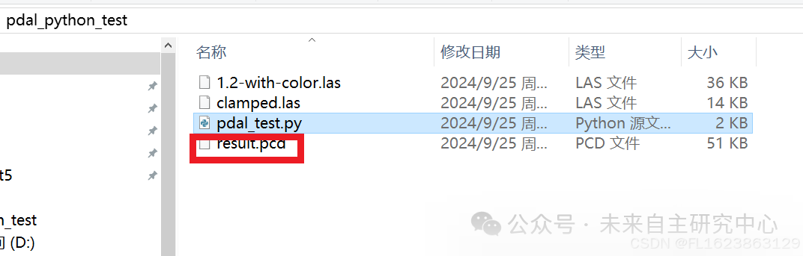
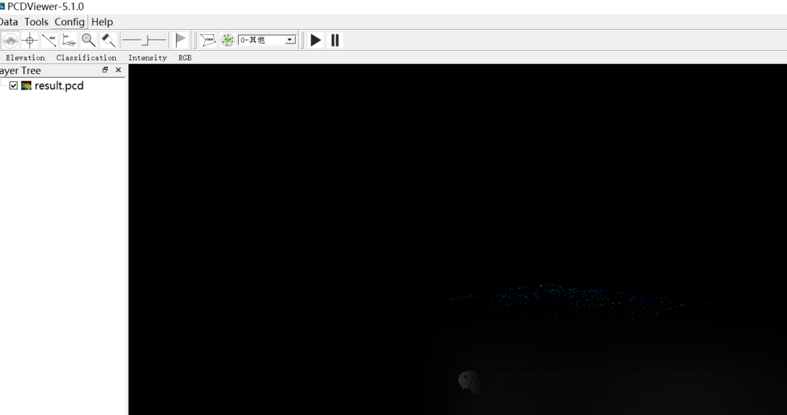

# [python-pdal] python-pdal installation test code

-
-
-
-
-
-
-
-
-
-
-
-
-
-
-
-
-
-
-
-
-
-
-
-
-
-
-
-
-
-
-
-
-
-
-
-
-
-
-
-
-
-
-
-

```
import pdalimport tiledb  data = "1.2-with-color.las" pipeline = pdal.Reader.las(filename=data).pipeline()print(pipeline.execute())  # 1065 points # Get the data from the first array# [array([(637012.24, 849028.31, 431.66, 143, 1,# 1, 1, 0, 1,  -9., 132, 7326, 245380.78254963,  68,  77,  88),# dtype=[('X', '<f8'), ('Y', '<f8'), ('Z', '<f8'), ('Intensity', '<u2'),# ('ReturnNumber', 'u1'), ('NumberOfReturns', 'u1'), ('ScanDirectionFlag', 'u1'),# ('EdgeOfFlightLine', 'u1'), ('Classification', 'u1'), ('ScanAngleRank', '<f4'),# ('UserData', 'u1'), ('PointSourceId', '<u2'),# ('GpsTime', '<f8'), ('Red', '<u2'), ('Green', '<u2'), ('Blue', '<u2')])arr = pipeline.arrays[0] # Filter out entries that have intensity < 50intensity = arr[arr["Intensity"] > 30]print(len(intensity))  # 704 points # Now use pdal to clamp points that have intensity 100 <= v < 300pipeline = pdal.Filter.range(limits="Intensity[100:300)").pipeline(intensity)print(pipeline.execute())  # 387 pointsclamped = pipeline.arrays[0] # Write our intensity data to a LAS file and a TileDB array. For TileDB it is# recommended to use Hilbert ordering by default with geospatial point cloud data,# which requires specifying a domain extent. This can be determined automatically# from a stats filter that computes statistics about each dimension (min, max, etc.).pipeline = pdal.Writer.las(    filename="clamped.las",    offset_x="auto",    offset_y="auto",    offset_z="auto",    scale_x=0.01,    scale_y=0.01,    scale_z=0.01,).pipeline(clamped)print(dir(pdal))pipeline |= pdal.Filter.stats() | pdal.Writer.pcd(filename="result.pcd")print(pipeline.execute())  # 387 points
```

Result:

A result.pcd file will be generated under the directory.



We open the pcd file using PCDViewer.



The complete test code download link: pdal_python_test.zip - BlueStacks


## Payment

Here is a pay link on Stripe ( https://buy.stripe.com/3cs8yP7sY87d0vu9AB ). Please contact me lonlonago@foxmail.com after funding $89, and I will send you a complete data files , thank you!


